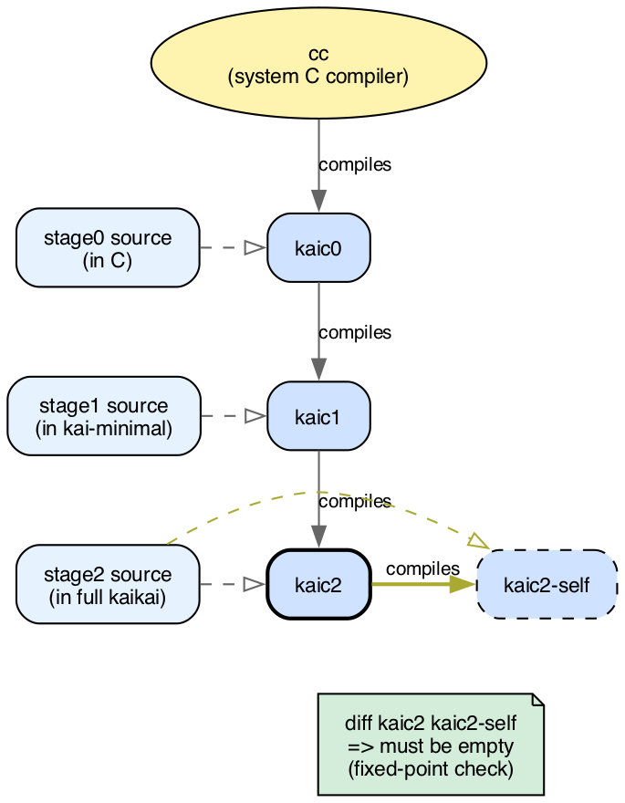

# Appendix A · Three-stage bootstrap

This appendix tells how the kaikai compiler is built from
nothing but a plain C compiler. You don't need it to program
in kaikai; it's an engineering decision with lasting
consequences.

Why does it matter how the compiler is compiled? Because it
defines whom you trust and why. A language whose compiler is
built from a plain `cc` and nothing else is a language anyone
can audit, reproduce, and maintain.

## A.1 The bootstrap problem

A compiler is a program, and like any program it has to be
compiled to run. Every new compiler hits the same paradox:
what compiles it the first time?

Three historical answers:

- **Write it in C (or assembly) the first time.** The
  classical route. GCC, MRI Ruby, CPython, V8 were born
  this way. The cost: the new compiler carries C's surface
  forever, or gets rewritten in itself later through a
  costly migration.
- **Write it in an existing language that already has a
  compiler.** That's what Rust did with OCaml initially,
  what Swift did with C++. It inherits the host language's
  dependencies: compiling Rust required installing OCaml,
  until Rust was rewritten in itself.
- **Incremental self-hosting.** Start with a small compiler
  (for a subset of the language), written in something
  portable, use it to compile a bigger compiler (written in
  the language), and so on. That's what kaikai does with
  its three stages.

## A.2 Stage 0: the compiler in C

`stage0` is a compiler written in standard C. Its only
dependency is any C compiler:

```sh
$ cc stage0/*.c -o kaic0
```

No frameworks, generators, or exotic libraries: plain C.
The file `stage0/runtime.h` is the runtime for compiled
programs: reference counters, list and string primitives,
panic. All of that fits in a few thousand lines.

What does `kaic0` compile? **kaikai-minimal**, a deliberate
subset of the language. The grammar and constructs in
kaikai-minimal are documented in `docs/kaikai-minimal.md`.
Left out: algebraic effects, fibers, protocols, contracts,
units of measure. It's the minimum to write a compiler.

Stage 0 is built to be auditable. If you want to understand
what's going on, you can read the C source line by line: lexer, recursive-descent parser, simple type checker,
C emitter. Five files.

## A.3 Stage 1: the compiler in kaikai-minimal

With `kaic0` working, the next step is a compiler written
**in kaikai-minimal**. This compiler, `stage1`, does something
`kaic0` can't: it compiles the **full** language. Effects,
fibers, protocols, contracts, all of it.

```sh
$ kaic0 stage1/main.kai -o kaic1
```

`kaic0` compiles `stage1` to produce an executable `kaic1`.
From here on, the C compiler is out of the picture: `kaic1`
is enough to process programs that use everything kaikai
offers.

It's the first self-validation: the compiler written in
kaikai-minimal proves that kaikai-minimal is expressive
enough to implement a full compiler. If it weren't, this
step wouldn't terminate.

## A.4 Stage 2: full kaikai, self-hosted

`stage2` is the definitive version, written in **full
kaikai** (not the minimal subset) with effects, fibers, and
everything the language offers: idiomatic kaikai end to end.

```sh
$ kaic1 stage2/main.kai -o kaic2
```

`kaic1` compiles `stage2` into `kaic2`, the compiler that
gets distributed. When you install kaikai you get `kaic2`,
not `kaic0` or `kaic1`.

The three stages, end to end:



Figure A.1 · *The three-stage bootstrap. Solid arrows show
which compiler produces which binary; the dashed arrows
point from each stage's source to the binary it becomes.
Only `cc` is external; once `kaic0` exists, the chain is
self-contained. The bottom row's fixed-point check
(`kaic2` compiling itself) is what §A.5 covers.*

## A.5 The fixed point: bootstrap validation

The process ends with a critical check:

```sh
$ kaic2 stage2/main.kai -o kaic2-self
$ diff kaic2 kaic2-self
```

They must be **bit-for-bit identical**: `kaic2` compiled by
`kaic1` produces exactly the same thing as `kaic2` compiled
by itself. `kaic2` is a fixed point of the compilation
process.

It matters for two reasons:

- **Detection of subtle compiler bugs.** If two compiler
  versions (`kaic1` and `kaic2`) produce different binaries
  from the same source, one of them has a bug. The fixed
  point confirms the whole chain converges to the same
  answer.
- **A foundation against the Thompson attack.** Ken
  Thompson published in 1984 a famous essay ("Reflections on
  Trusting Trust") showing that a malicious compiler can
  insert invisible backdoors that survive recompilation.
  The known defense is **diverse double-compiling** (David
  A. Wheeler, 2005): compile the compiler's source with a
  second, independent chain and compare the binaries. The
  fixed point alone doesn't protect you, because a trojaned
  compiler also reproduces itself bit for bit. What it
  contributes is the deterministic compilation that
  comparison depends on.

## A.6 Reproducible from a `cc`

The practical consequence: **with just a C compiler, you can
rebuild kaikai entirely from source**. No kaikai installed
beforehand, no binary downloaded from a web page to trust, no
`curl | bash`.

```sh
$ git clone https://github.com/kaikailang-org/kaikai
$ cd kaikai
$ make
```

Underneath, `make` runs the three steps: stage 0 with cc,
stage 1 with stage 0, stage 2 with stage 1. It leaves a
`kaic2` in `bin/`, and the fixed-point check ensures it's the
right one.

This is technical freedom few modern languages give you.
Rust requires a previous Rust (downloaded as a blob). Go
requires a previous Go. Swift requires a previous Swift.
kaikai doesn't: your C compiler is the entry point.

## A.7 Costs and trade-offs

Like every engineering decision, the three-stage bootstrap
has costs:

- **Stage 0 has to be maintained whenever kaikai-minimal
  changes.** If a new language feature falls within the
  minimal subset, stage 0 has to learn it. That means new
  C code, written by hand.
- **It's expensive to add dependencies to the compiler.**
  Stage 2 might benefit from an external library (a parser
  combinator, an exotic data structure). But that library
  would have to be available in stage 1, which only
  understands kaikai-minimal. The pressure is toward
  keeping stage 2 self-contained.
- **Building everything from scratch takes time.** Not
  much (the three steps together take less than a minute
  on a reasonable machine), but more than a single `cargo
  build`. For continuous CI, that matters.

Is it worth it? The project's answer is yes, and the
reason is philosophical: the compiler is the most trusted
piece of software in the ecosystem. If the chain of trust
can be audited end-to-end from plain C, then the rest
follows.

## A.8 Going further

The design decisions live in `docs/design.md` at
`github.com/kaikailang-org/kaikai`; the files, under
`stage0/`, `stage1/`, and `stage2/` in the repository. If you
care about the philosophical justification for this approach,
read Ken Thompson's *Reflections on Trusting Trust* (CACM
1984).
