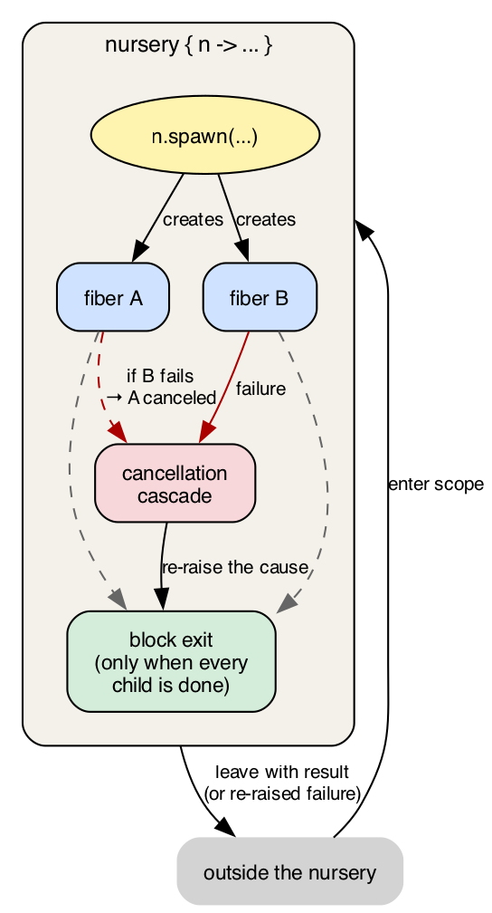

# Chapter 13 · Concurrency and memory

Concurrency is where most languages accumulate debt. Threads
with shared memory lead to races that show up once a month
and get fixed three times before they actually go away;
`async`/`await` introduces function colors; actors fix the
previous problems but historically come with a GC and a heavy
runtime.

Against those three, kaikai bets on an unusual combination:
**cooperative fibers + per-fiber memory + Perceus**. Three
consequences, before the syntax:

- **No shared memory between fibers.** Each fiber has its own
  heap. What one passes to another is copied, so data races
  can't arise by construction.
- **No GC, no borrow checker.** Perceus frees memory when
  the last use of each value ends, without an asynchronous
  collector and without asking you to annotate lifetimes.
  The compiler figures out where to put the `free`s.
- **Concurrency is an effect.** `spawn` is an operation of a
  `Spawn` effect, not a keyword. Creating and awaiting
  fibers composes with the rest of the system (`State`,
  `Cancel`, a `Fail` you declare yourself) using the
  chapter-12 machinery.

## 13.1 The model: isolated fibers

A **fiber** is a unit of execution similar to a thread, but
much lighter: hundreds of bytes instead of megabytes. A kaikai
application can have thousands or hundreds of thousands of
live fibers without breaking a sweat.

Fibers are **cooperative**. The runtime spreads them across
several OS threads (§13.8), and on its thread each fiber runs
until it hits a **yield point**: a call that hands control
back to the scheduler. Nothing interrupts it halfway. Yield
points are explicit:

- `spawn.yield()`: "I've run for a while, try another".
- `spawn.await(f)`: "wait until fiber `f` finishes".
- IO operations that the scheduler intercepts (network
  reads, sleep, etc.).

Without yields, a fiber runs to completion. Other fibers may
be running at the same time on other threads, but none of
them can reach your data, because each fiber has its own
memory (more on that next). That's **local determinism**:
inside a fiber, you know exactly what happens to your values.
Compared to preemptive threads over shared memory, you lose a
whole class of bugs: there's no race over the data you touch.

The trade-off is that a fiber that never yields hogs its
thread and doesn't notice when it's cancelled. With a single
thread (`KAI_THREADS=1`, §13.8) it blocks every other fiber.
Adding yields where they make sense is on you; in
practice IO calls already include them, and you only think
about manual yields in a tight CPU-heavy loop.

### Per-fiber memory

Each fiber has its **own heap**. When a fiber creates a
record, a list, or a closure, the space comes from that heap,
and no other fiber can read or write it. The type system
guarantees this.

Two fibers communicate by passing values. When a fiber sends a
message to another (via an actor mailbox or the result of an
`await`), the value is copied to the receiver's heap. An
`Int` costs nothing; a big list costs in proportion to its
size. That cost is what lets Perceus reference counting
(§13.2) do without atomic instructions, even when sender and
receiver run on different threads.

The guarantee that matters: **there's no way for two fibers
to hold a pointer to the same object**. Data races, memory
visibility problems, cache coherence bugs — everything that
in traditional threads needs `Atomic` reads/writes or locks
simply doesn't exist here.

## 13.2 Perceus in one page

With no GC and no borrow checker, memory is freed by a third
approach: **strict reference counting driven by Perceus**
(Lorenz, Leijen, Reinking, 2021).

The compiler analyzes each function to find the exact point
where each value is last used, and there it inserts an
instruction that decrements the value's reference count: if
it hits zero, the value is freed; if not, it stays for
another use.

```kai
fn example(xs: [Int]) : Int {
  let n = list.length(xs)   # first use of xs
  let s = list.sum(xs)       # last use of xs: consumed here
  s + n                      # xs no longer exists; n and s do
}
```

Compared to a GC:

- **No pause.** Freeing is synchronous, predictable, part of
  the generated code.
- **No asynchronous overhead.** The compiler knows the exact
  lifetime of each value.
- **No separate thread.** The scheduler doesn't compete with
  a collector.

Compared to a borrow checker:

- **No lifetime annotations.** No `'a`, no `&`, no `mut`.
- **No restrictions on use patterns.** If you need two
  references to the same value, the compiler inserts the
  necessary increments and decrements.

The cost: when a value is used many times, counters move.
For heavily shared values that adds overhead, and Perceus
includes aggressive optimizations to minimize it (reuse in
place: if a value is about to be freed and a value of the
same shape is needed immediately after, the same memory is
reused without touching the counter). In practice the cost
is low and predictable.

For the extreme case — a computation that builds mountains
of throwaway structure only to fold it down to a scalar —
there is an opt-in escape: the `region` block, which
allocates in an arena and frees it wholesale, no counters
involved. It belongs to the same kind catalog as chapter
10's units, and you meet it in chapter 19.

Why this matters for concurrency: Perceus works per fiber.
Each fiber has its own counters and its own frees, and no
counter needs synchronization between fibers, because no two
fibers ever share pointers to a value with a shared count.
That's why the "isolated fibers" model fits so cleanly with
Perceus: the same invariant that rules out data races also
keeps the reference counting lock-free.

## 13.3 Creating and awaiting fibers: the basic operations

The simplest way to use fibers is with `spawn.spawn` and
`spawn.await`:

```kai
import spawn

fn worker(tag: String, n: Int) : Unit / Stdout + Spawn {
  if n > 0 {
    println(tag)
    spawn.yield()
    worker(tag, n - 1)
  }
}

fn main() {
  let f = spawn.spawn(() => worker("B", 3))
  worker("A", 3)
  spawn.await(f)
}
```

One possible output:

<!-- transcripto: nondeterministic order, as the text says -->
```
$ kai run examples/ch13/01_two_fibers.kai
A
B
A
B
A
B
```

**"One possible output" is literal.** This program promises no
such order. `A` and `B` are independent fibers: nothing in the
code says the first `A` comes before the first `B`. The
runtime spreads fibers across as many OS threads as your
machine has cores, so you'll see different orders run to run —
`A A A B B B` is as valid as the interleaving above.

For perfectly alternating output:

```
$ KAI_THREADS=1 kai run examples/ch13/01_two_fibers.kai
A
B
A
B
A
B
```

`KAI_THREADS=1` pins the scheduler to a single thread, and
there `spawn.yield()` is the only thing deciding whose turn it
is. Use that mode to read this chapter's examples whenever
the point is to *see* the alternation. You come back to this
in §13.8; for now, hold on to the idea that the alternation
is a property of the single-threaded scheduler, not a
guarantee of the language.

Reading literally:

- `import spawn` brings in the fiber operations.
- `spawn.spawn(() => worker("B", 3))` creates a new fiber
  that will run the lambda when the scheduler picks it.
- `worker("A", 3)` runs in the current fiber (`main`'s).
- `spawn.yield()` inside `worker` hands control back: the
  fiber declares a point where it may lose its turn.
- `spawn.await(f)` waits for `f` to finish before `main`
  returns.

`Spawn` appears in `worker`'s signature because the function
calls `spawn.yield()`, which is a `Spawn` operation. The row
propagates upward like any other effect from chapter 12.

### Why yields are explicit

In languages with preemptive threads (Java, Go, Rust with
`std::thread`), the scheduler can interrupt a thread at any
instruction, which forces you to program as if any line
could be interrupted by another fiber modifying shared
data.

In kaikai, **a fiber keeps running until it hits a yield
point**. Between yields you have local determinism: no other
fiber runs on your thread, and the ones running on other
threads have no way to reach your values. This drops a lot of
cognitive load.

In exchange, you have to **remember to yield**. The mental
rule: if your function has a long pure-CPU loop, add a
`spawn.yield()` every so many iterations. IO functions
already yield internally.

## 13.4 Nurseries: structured concurrency

`spawn.spawn` + `spawn.await` works, but if you forget the
`await`, the fiber outlives the scope that created it. And if
that fiber fails, you find out late or not at all.

**Nurseries** tie fibers to a lexical scope. A fiber can
only live inside a nursery, and the nursery waits for all
its children before exiting.

```kai
# examples/ch13/02_nursery.kai
import spawn

fn worker(tag: String, n: Int) : Unit / Stdout + Spawn {
  if n > 0 {
    println(tag)
    spawn.yield()
    worker(tag, n - 1)
  }
}

fn main() : Unit / Stdout + Spawn + Cancel {
  nursery { n ->
    n.spawn(() => worker("A", 3)) |> ignore
    n.spawn(() => worker("B", 3)) |> ignore
  }
}
```

One possible output:

<!-- transcripto: nondeterministic order, as the text says -->
```
$ kai run examples/ch13/02_nursery.kai
A
A
A
B
B
B
```

`nursery { n -> ... }` opens a scope. Inside, `n` is the
capability to create fibers:

- `n.spawn(f)` creates a child fiber. Returns a `Fiber[T]`
  where `T` is what `f` returns. You don't need it here, since
  the nursery waits for the fibers anyway, and `|> ignore` says
  you are dropping it on purpose.
- `n.await(f)` waits for that fiber and returns its value. You
  only need it when you want the result.
- `n.select([a, b, ...])` waits for any one to finish and
  cancels the others.
- `n.cancel(f)` cancels a specific fiber.
- `n.cancel_all()` cancels all children.

What the nursery guarantees:

- **By block exit, all children have finished.** The nursery
  *joins* every child automatically at the closing brace, with
  no `await` required. No leaks: a fiber doesn't outlive the
  `nursery` that created it.
- **If a child fails on its own, the others are canceled.**
  When a child raises `Cancel` without anyone requesting it (a
  crash), the nursery cancels the siblings still alive and
  re-raises the cause out of the scope. A child you cancel on
  purpose with `n.cancel`, by contrast, finishes as an expected
  outcome and does not spread to the others.
- **If the nursery is canceled from outside, the
  cancellation propagates to all children.**



Figure 13.1 · *Structured concurrency in one picture. The
nursery is a lexical scope; child fibers live inside; nothing
escapes. If one child fails, the nursery cancels the rest
before re-raising; if the parent is canceled from outside,
the cascade flows down.*

This is called **structured concurrency**. The idea is
Nathaniel Smith's, in his essay *"Notes on structured
concurrency, or: Go statement considered harmful"* (2018),
and appears also in Trio, Kotlin coroutines, Swift, and
OCaml 5 Eio. kaikai integrates the pattern into the effect
system: the `Spawn` capability is only available inside a
nursery, and the type system enforces it.

`n.select` is the racing primitive: the nursery returns the
value of whichever child finishes first and cancels the other
without being asked.

```kai
# examples/ch13/04_race.kai
import spawn

fn fast() : Int / Stdout + Spawn {
  println("fast: start")
  spawn.yield()
  println("fast: done")
  1
}

fn slow() : Int / Stdout + Spawn {
  println("slow: start")
  spawn.yield()
  spawn.yield()
  spawn.yield()
  println("slow: done")
  2
}

fn main() : Unit / Stdout + Spawn + Cancel {
  let winner = nursery { n ->
    let a = n.spawn(() => fast())
    let b = n.spawn(() => slow())
    n.select([a, b])
  }
  println("winner: #{winner}")
}
```

One possible output:

<!-- transcripto: nondeterministic order, as the text says -->
```
$ kai run examples/ch13/04_race.kai
fast: start
fast: done
slow: start
winner: 1
```

### Why `Cancel` appears in `main`'s signature

`main` declares `/ Stdout + Spawn + Cancel` because each
`spawn`, `await`, and `select` is a yield point, and every
yield point can receive a
`Cancel.raise()` from the scheduler (if someone cancels the
nursery from outside, or if a sibling fiber fails). Every
function using `Spawn` implicitly carries `Cancel`.

### `nursery` is sugar over `handle`

`nursery { n -> ... }` looks like a language keyword but
it isn't. Fibers are **an effect** called `Spawn`, declared
in the stdlib:

```kai
effect Spawn {
  spawn[T, e](f: () -> T / e) : Fiber[T]
  await[T](f: Fiber[T])       : T
  select[T](fs: [Fiber[T]])   : T
  yield()                     : Unit
  cancel[T](f: Fiber[T])      : Unit
}
```

It's an ordinary effect, declared the same way `Log` or
`State[T]` were in chapter 12. And `nursery { n -> body }`
is rewritten at compile time to `handle { body } with Spawn
as n { ... }`, with an internal handler that manages the
child tree, waits for pending children on exit, and
propagates failures.

So the language core **has no concurrency primitives**: it
has effects. Fibers, nurseries, and cancellation are a
library built on two stdlib effects (`Spawn` and `Cancel`).
In chapter 14 actors repeat the pattern (effect
`Actor[Msg]`): what's distinctive about kaikai is that all
its constructs are the same one — algebraic effects — under
different names.

To keep the results instead of merely waiting for them, one
`await` per child:

```kai
# examples/ch13/05_worker_pool.kai
import spawn

fn process(id: Int, x: Int) : Int / Stdout + Spawn {
  println("worker #{id}: processing #{x}")
  spawn.yield()
  spawn.yield()
  let r = x * x
  println("worker #{id}: done #{x} -> #{r}")
  r
}

fn main() : Unit / Stdout + Spawn + Cancel {
  let results = nursery { n ->
    let a = n.spawn(() => process(1, 3))
    let b = n.spawn(() => process(2, 5))
    let c = n.spawn(() => process(3, 7))
    [n.await(a), n.await(b), n.await(c)]
  }
  println("results: #{results}")
}
```

One possible output:

<!-- transcripto: nondeterministic order, as the text says -->
```
$ kai run examples/ch13/05_worker_pool.kai
worker 1: processing 3
worker 1: done 3 -> 9
worker 2: processing 5
worker 3: processing 7
worker 3: done 7 -> 49
worker 2: done 5 -> 25
results: [9, 25, 49]
```

## 13.5 Cooperative cancellation

Cancellation in kaikai is **cooperative**: the scheduler
doesn't kill a fiber outright. It delivers a `Cancel.raise()`
at the next yield point. The fiber can:

- **Unwind cleanly.** If it doesn't handle `Cancel`, the
  unwinding pulls it out of any `handle`, `nursery`, etc.,
  and the cancellation handlers above take control.
- **Handle `Cancel` to clean up.** The fiber installs a
  `Cancel` handler that runs the cleanup (close files,
  release connections) and does NOT call `resume`, letting
  the unwinding continue.

```kai
fn long_worker(tag: String) : Unit / Stdout + Spawn + Cancel {
  handle {
    count(tag, 0)
  } with Cancel {
    raise(resume) -> {
      println("#{tag}: canceled, doing cleanup")
      # not calling resume: the fiber unwinds
    }
  }
}

fn count(tag: String, n: Int) : Unit / Stdout + Spawn + Cancel {
  println("#{tag}: #{n}")
  spawn.yield()
  count(tag, n + 1)
}
```

`long_worker` counts indefinitely. If the nursery cancels
it, the `Cancel` handler prints its message and the fiber
exits, without hanging or killing the process.

The conceptual key: `Cancel.raise()` is the **operation**,
and `handle ... with Cancel { ... }` is the handler. Same
pattern as chapter 12: cancellation is another effect, with a
handler you write or the runtime installs.

### `Spawn.cancel(f)` and user-installed `Cancel` handlers

Two related names to keep apart:

- **The `Cancel` effect** is what a fiber **receives** when
  cancellation reaches it. Its single op `raise()` is injected
  by the scheduler at the next yield point.
- **`Spawn.cancel(f)`** is what a fiber **calls** to ask the
  scheduler to deliver `Cancel.raise()` to fiber `f`.

When you `n.spawn(...)` with a nursery cap `n` and get back a
child fiber, `Spawn.cancel(child)` does not kill it: it
schedules the delivery. The child, on its next yield, receives
`Cancel.raise()` and runs its own `Cancel` handler, the one it
installed with `with Cancel { ... }`. If it installed none, it
unwinds cleanly and any handlers further up the stack
(typically the nursery's) take over.

The one exception is **trap-exit** in the actor model
(ch. 14): a fiber can mark itself so that peer crashes reach
its mailbox as messages instead of triggering cancellation.
That's an explicit local opt-in; the default remains the
cooperative cancellation described here.

A child that gives up on its own, the siblings that get the
cancellation, each one's cleanup, and the failure the nursery
re-raises on the way out:

```kai
# examples/ch13/03_cancel.kai
import spawn

# A fiber that counts as long as nobody cancels it.
fn long_worker(tag: String) : Unit / Stdout + Spawn + Cancel {
  handle {
    count(tag, 0)
  } with Cancel {
    raise(resume) -> {
      println("#{tag}: canceled, doing cleanup")
      # not calling resume: the fiber unwinds
    }
  }
}

fn count(tag: String, n: Int) : Unit / Stdout + Spawn + Cancel {
  println("#{tag}: #{n}")
  spawn.yield()
  count(tag, n + 1)
}

# A fiber that gives up after a few steps.
fn quit(n: Int) : Unit / Stdout + Spawn + Fail {
  if n > 2 {
    Fail.fail("quitting after 3 steps")
  } else {
    println("step #{n}")
    spawn.yield()
    quit(n + 1)
  }
}

effect Fail {
  fail(reason: String) : Nothing
}

fn main() : Unit / Stdout + Spawn + Cancel {
  nursery { n ->
    n.spawn(() => long_worker("A")) |> ignore
    n.spawn(() => long_worker("B")) |> ignore
    let r = n.spawn(
      () => handle {
        quit(0)
      } with Fail {
        fail(reason, resume) -> {
          println("the fiber gives up: #{reason}")
          Cancel.raise()
        }
      }
    )
    n.await(r)
  }
}
```

One possible output:

<!-- transcripto: nondeterministic order, as the text says -->
```
$ kai run examples/ch13/03_cancel.kai
A: 0
A: 1
A: 2
A: 3
B: 0
A: 4
A: 5
B: 1
A: 6
B: 2
A: 7
A: 8
A: 9
A: 10
B: 3
A: 11
step 0
step 1
B: 4
step 2
the fiber gives up: quitting after 3 steps
A: 12
A: canceled, doing cleanup
B: 5
B: canceled, doing cleanup
kai: nursery child cancelled; no survivors
```

## 13.6 Per-fiber mutable memory

In chapter 12 §12.7 you met `var` (local cells, sugar over
`State[T]`) and the `Mutable` effect (which rules `Ref[T]`
and `Array[T]` when the mutation is observable). All of it
works the same as in sequential code, with one addition from
the fiber model: **mutable memory lives in the heap of the
fiber that created it**.

When a fiber creates an `Array[T]` or a `Ref[T]`, the space
comes from its own heap, and no other fiber can reach it: no
shared pointers, no reference passing between fibers. To give
a mutable value to another fiber, you send it through a
mailbox (chapter 14) and the runtime copies the contents to
the receiver's heap.

That's why mutation doesn't introduce data races in kaikai.
With threads and shared memory, a mutable `Array[T]` needs
locks or atomics to be touched from several threads. In kaikai, the type system
guarantees that no `Array[T]` is being modified by two
fibers at the same time, because no `Array[T]` is reachable
from two fibers at the same time. The memory isolation of
§13.1 covers mutable cells too.

## 13.7 Why fibers can't escape their nursery

A detail of the type system: **`Fiber[T]` is a handle bound
to its nursery**. No function can return one, bare or
wrapped: the compiler rejects `Fiber[T]` anywhere in a return
type, be it `Option[Fiber[Int]]`, `[Fiber[Int]]` or the
payload of a sum type.

```kai
fn doesnt_compile() : Fiber[Int] {       # ERROR
  nursery { n ->
    n.spawn(() => 42)                     # can't return
  }
}
```

A fiber only makes sense inside the nursery that created it.
If you could return it, who would await it? Who would cancel
it when the nursery ends? The structure breaks.

Inside the nursery, on the other hand, you can keep a
`Fiber[T]` in a list, an `Option` or a record, or capture it
in the closure of a sibling fiber that awaits it. A list of
fibers is the typical case:

```kai
nursery { n ->
  let fibers = [1, 2, 3] | (x) => n.spawn(() => process(x))
  fibers | (f) => n.await(f)
}
```

That list lives inside the nursery and can't escape.

This closes the model: each fiber has a known parent and ends
before it, and the type system guarantees it syntactically,
not by convention. **There's no
way for a fiber to be orphaned.**

## 13.8 Case study: splitting work across fibers

We close with a pattern you'll write many times: split a list
of tasks across several worker fibers and collect the results
at the end.

Before the code, a constraint that decides the shape of the
solution: **effect handlers are fiber-local**. Install a `State` handler in `main`, have a
child fiber run `State.get()`, and the program doesn't even
compile:

```
error: effect not handled in spawned fiber: State
  --> main.kai:6:23
    |
  6 |       let f = n.spawn(() => State.get())
    |                       ^
  = note: a fiber does not inherit the parent's handlers
  = help: handle the effect inside the spawned body: `handle { ... } with State { ... }`
```

It's the same isolation invariant that holds up the whole
chapter: a capability is part of a fiber's context, and a
fiber does not inherit the context of whoever created it. What you hand across a `spawn`
is the values you capture in the lambda on the way in, and the
return value `await` collects on the way out. The capabilities
that do resolve inside a child come in two kinds, and neither
is yours: the ones the runtime supplies per fiber (`Stdout`,
`Clock`), and the ones that belong to the fiber by construction
(`Cancel`, `Spawn`, `Actor`).

The compiler stops it on the `spawn` line, where the mistake
is, rather than letting it blow up at runtime when the fiber
reaches the operation.

So the "shared queue" you'd write in Go with a channel, or in
Java with a `BlockingQueue`, isn't written that way here. You
split the work up front and each fiber returns its own share:

```kai
import spawn
import core.list

fn process_batch(id: Int, batch: [String]) : [String] / Spawn =
  batch
    | (t => {
      spawn.yield()
      "worker #{id}: #{t}"
    })
```

`process_batch` doesn't know other fibers exist: it takes its
batch, walks it, and builds the output list. The
`spawn.yield()` is there so the workers take turns; it doesn't
change the result, it just makes the thing genuinely
concurrent.

`main` splits, waits, and concatenates:

```kai
fn main() : Unit / Stdout + Spawn + Cancel {
  let results = nursery { n ->
    let a = n.spawn(() => process_batch(1, ["alpha", "bravo"]))
    let b = n.spawn(() => process_batch(2, ["charlie", "delta"]))
    let c = n.spawn(() => process_batch(3, ["echo", "foxtrot"]))
    n.await(a) ++ n.await(b) ++ n.await(c)
  }
  results |! println(.)
  println("(#{list.length(results)} tasks processed)")
}
```

Output:

```
$ kai run examples/ch13/06_batch_split.kai
worker 1: alpha
worker 1: bravo
worker 2: charlie
worker 2: delta
worker 3: echo
worker 3: foxtrot
(6 tasks processed)
```

This time the output **is** guaranteed. The fibers run however
they like, on whatever cores are around, but none of them
prints: they only return lists, and `main` concatenates them
in the order it chose when it wrote `n.await(a) ++ n.await(b)
++ n.await(c)`, and only then prints. The output order is a
consequence of the code, not of the scheduler.

That's a design rule worth more than the example itself: **if
you care about order, impose it at the join point — don't
trust the order of execution.**

And if the work can't be split up front — if tasks arrive over
time, or vary so much in length that you want whichever fiber
frees up to take the next one? Then you need something that
owns the queue and answers requests. That something is an
actor, and that's chapter 14.

### Concurrency and parallelism

Two words that get conflated constantly:

**Concurrency** is a property of your program: having several
lines of work alive at once, progressing independently.
**Parallelism** is a property of the machine: two of those
lines executing instructions at the same instant, on different
cores.

kaikai gives you both. Fibers, cooperative and tied to a
nursery, are the concurrency mechanism, and the runtime
spreads them by default across as many OS threads as the
machine has cores, with an M:N scheduler that steals work
between threads. You request and configure nothing: the
program you wrote in §13.3 already uses your sixteen cores if
you have them.

What does **not** change with the thread count is the
semantics:

- Each fiber still has its own memory. A message crossing from
  one thread to another is copied, so Perceus reference
  counting still needs no atomics.
- Fibers are still cooperative: none is interrupted mid
  instruction. Between two yields, a fiber has local
  determinism.
- Nurseries, cancellation and `await` behave the same at one
  thread or at thirty-two.

What does change is what you already saw: **the order in which
independent fibers interleave stops being predictable.** On one
thread, `spawn.yield()` decides the turns and the output is
reproducible; on several, it isn't. That's what
`KAI_THREADS=1` is for: it forces the single-threaded
cooperative scheduler. It's the tool for debugging a race, for
a test that compares literal output, or for reading a teaching
example like the ones in this chapter.

```sh
$ ./program                  # as many threads as cores
$ KAI_THREADS=4 ./program    # four, no more, no less
$ KAI_THREADS=1 ./program    # cooperative, reproducible
```

The useful question is whether it helps you. If your program
is IO-bound — waiting on the network, reading files, receiving
messages — fibers pay off even on one thread, because while
one waits for bytes the others run. If it's CPU-bound, they
give you speed as well as structure, as long as the work
splits into pieces that don't depend on each other. The
example in this section is exactly that shape.

## 13.9 Philosophy: two invariants worth remembering

Keep two things from this chapter:

1. **Each fiber has its own heap.** No shared memory between
   fibers. Communication is by message (actor mailbox,
   `await` result). Data races don't exist by construction,
   not by discipline.

2. **Each fiber has a life tied to a lexical scope.** It
   can't escape the `nursery` that created it; the type
   system rejects any attempt. If the parent ends, every
   child has ended. If a child fails, the siblings are
   canceled.

These two invariants support each other. Memory isolation
is what lets Perceus run per fiber without synchronization.
Lexical structure is what lets memory be freed predictably
at scope exit. Any model that breaks one of the two breaks
the other.

In return, you stop thinking about whole classes of bugs:

- No `volatile`, no `Atomic`, no memory ordering.
- No `lock`, no `mutex`, no `RwLock`.
- No borrow checker, no `'a` lifetimes, no
  `Rc<RefCell<T>>`.
- No `async fn`, no `Future`, no function colors.
- No GC pause-the-world.

It's a trade-off: you give up the freedom to have arbitrary
pointers between fibers. What you gain in safety and mental
simplicity justifies the model.

## Exercises

**13.1.** Modify the §13.3 example (two cooperative fibers)
so that `worker("A")` does 5 iterations and `worker("B")`
does 2. How does the output change? What happens if you
remove the `spawn.yield()`s from one worker only?

**13.2.** A fiber creates an `Array[Int]` locally and
modifies it with `a[i] := v`. Then it exits without passing
it to anyone. Why doesn't this program introduce data races
even if another fiber is running concurrently? Answer in two
lines, in terms of the per-fiber memory model from §13.1.

**13.3.** Implement a function `with_timeout[T](ms: Int, f:
() -> T / Spawn) : Option[T] / Spawn + Cancel + Time`. Use
`n.select` to run `f` against a fiber that does
`Time.sleep(ms)` and returns `None`. Hint: you'll need a
local sum type to distinguish "completed" from "timeout".

**13.4.** §13.8 splits the batches up front and evenly. Modify
it so the batches are wildly uneven (one with ten tasks, two
with one) and time the whole run. Then split the same eleven
tasks into three even batches and time it again. Why does
static splitting leave cores idle, and what would you need to
avoid it?

**13.5.** A fiber that enters an infinite loop without
`spawn.yield()` never gives up its turn. Write that code and
observe what happens: first under `KAI_THREADS=1`, then
without the variable. Why does the symptom change? Then add
yields every N iterations. How often? How do you choose N?

**13.6.** In your usual language, find a concurrent program
you wrote or maintain. Count how many lines are "real work"
(the program's logic) vs how many are "concurrency
plumbing" (mutex, queues, atomics, async/await, callbacks).
Estimate what percentage of the code would remain under
kaikai's model.
