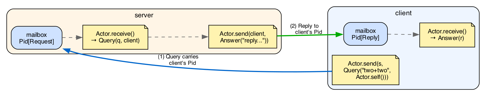

# Chapter 14 · Actors

In chapter 13 you learned to start fibers and coordinate them
with a nursery. That solves internal concurrency: many units
of work inside the same program, spread across the machine's
cores.

For many cases that structure is enough, but there's a
pattern that pure fibers leave awkward.

## An actor is a process; a fiber is a computation

Imagine two different tasks:

- **Task A:** parse a large file and return the list of
  errors found. Starts, works, ends, returns a value.
- **Task B:** maintain an in-memory cache that answers
  queries (`get(key)` and `put(key, value)`). Starts, stays
  alive, answers messages for as long as the program lives,
  ends when someone asks it to stop.

Both are concurrent: the main program keeps working while
they happen. But their shape is very different.

Task A is a **computation**: it has an input, produces an
output, and ends. That's a **fiber**: you create it with
`spawn`, wait for its result with `await`, and once the
result is returned the fiber ceases to exist.

```kai
let f = spawn.spawn(() => parse_file("input.txt"))
# ... other work in parallel ...
let errors = spawn.await(f)   # one value, and you're done
```

Task B is a **live process**: it has no single return value,
just an endless sequence of interactions. For that, kaikai
borrows the **actor** model, drawn in spirit from Erlang and
BEAM.

```kai
let cache = spawn_actor(() => cache_loop())
Actor.send(cache, Put("user:42", "ada"))
Actor.send(cache, Put("user:43", "turing"))
match Actor.receive() {
  Found(v) -> ...
  Missing  -> ...
}
```

An actor is **a fiber with a typed mailbox on top**. The
fiber is the substrate (a cooperative thread of execution);
the mailbox is what makes it an actor (a channel where
messages pile up for the fiber to process in order).

Side by side:

| Aspect | Fiber | Actor |
|---|---|---|
| What is it? | Unit of execution | Fiber with typed mailbox |
| Communication | One return value via `await` | Messages via `send`/`receive` |
| Lifecycle | Start, compute, return, die | Start, loop processing, die when it decides |
| How to create | `spawn.spawn` or `n.spawn` | `spawn_actor` |
| How you talk to it | `await` to get its `T` | `send` any number of times |
| When to pick | Discrete concurrent computation | Long-lived service, internal state, queries |

The mental rule:

- **Does the task end with a value the parent needs?** Fiber.
- **Does the task live and respond to messages from several
  clients?** Actor.

Both models are **concurrent and parallel**: the runtime
spreads fibers and actors across as many OS threads as the
machine has cores (chapter 13 §13.8 *Concurrency and
parallelism*). An actor running on another thread changes
nothing in this chapter: its mailbox is still processed
serially, one message at a time, and messages crossing a
thread boundary are copied. No actor observes shared memory,
whether you run on one thread or thirty-two.

Cases where an actor is natural: a cache server, a connection
controller, a process supervisor, a notification router, a
task queue, a logger actor. Cases where a fiber suffices: an
expensive computation the parent wants to run concurrently
with other work, a `with_timeout` measuring how long
something takes, a concurrent map over a list of IO.

Of everything in kaikai, this is the part that is least mine.
Erlang settled the split between a computation and a live
process decades ago, and I took it almost unchanged.

## Actors are not language primitives

In kaikai, actors aren't a core construct. They're a **layer built with
algebraic effects**: the `Actor[Msg]` effect declares the
operations (`self`, `send`, `receive`); the stdlib provides
functions like `with_mailbox` and `spawn_actor` that install
the `Actor[Msg]` handler on top of an ordinary fiber.

It's the same principle as `nursery` from chapter 13: the
language core has only effects; the use patterns (fibers,
actors, supervision) appear in libraries you can read. If
after this chapter you wonder how `spawn_actor`
works inside, the answer is a `spawn.spawn` plus a
`handle ... with Actor[Msg]`.

## 14.1 `Actor[Msg]`: the effect

An actor is a fiber inside a `handle ... with Actor[Msg]`
that grants it access to four operations, declared in the
stdlib:

```kai
# Declared in stdlib/effects/concurrent.kai, accessible via
# `import actor`.
pub effect Actor[Msg] {
  self()                        : Pid[Msg]
  send[T](pid: Pid[T], msg: T)  : Unit
  receive()                     : Msg
  receive_timeout(nanos: Int)   : Option[Msg]
}
```

- **`self()`** returns the `Pid` of the current actor. The
  `Pid` is the handle others use to send it messages.
- **`send(pid, msg)`** enqueues `msg` in `pid`'s mailbox. Note
  the `[T]`: the message type is **the destination's**, picked
  per call, and has nothing to do with the sender's own `Msg`.
  An actor whose mailbox is `Reply` can send a `Request` to a
  `Pid[Request]`, the way Erlang's `!` sends to any pid. If the
  destination mailbox is full, the behavior depends on the
  policy (§14.4).
- **`receive()`** takes the next message from the current
  actor's mailbox. If there's nothing, the fiber suspends until
  one arrives. That block is a yield point: it's where the
  scheduler delivers cancellation to a cancelled fiber.
- **`receive_timeout(nanos)`** is `receive()` with a deadline.
  It returns `None` if the deadline passes with nothing in the
  mailbox. You use it through its typed wrapper in §14.3.

`Msg` is the concrete type of the messages that actor
**receives**. An actor receives a single message type; sending
is a different matter, and that's what `send`'s `[T]` is for.
If you need to mix shapes in what you receive, unify them with
a sum type:

```kai
type ServerMsg
  = Ping(Pid[Pong])
  | Stop
  | Tick
```

The actor knows it'll receive only one of those three
constructors, and the exhaustive `match` on `receive()`
guarantees you cover every case.

### `Pid[Msg]`: typed handle

A `Pid[Msg]` is a mailbox identifier. It has a type, so the
compiler doesn't let you send a `Notification` message to a
`Pid[Task]`. This is the strongest difference from Erlang:
in Erlang, PIDs are untyped; in kaikai, they're specific to
the message type.

Like `Fiber[T]` from chapter 13, `Pid[Msg]` is **tied to the
scope that created it**. You can't store it in a record that
outlives the nursery, return it from a function outside the
standard family, or pass it between data structures that
aren't approved. The compiler rejects it. This closes the
model: every PID has a known parent, and dies with it.

## 14.2 `with_mailbox`: give the current fiber a mailbox

The simplest way to start is to give a mailbox to the fiber
you're already in. `with_mailbox` installs the `Actor[Msg]`
handler and hands control to its body:

```kai
import actor

fn main() : Unit / Stdout {
  with_mailbox {
    Actor.send(Actor.self(), "hello")
    Actor.send(Actor.self(), "world")
    Stdout.print(Actor.receive())
    Stdout.print(Actor.receive())
  }
}
```

Output:

```
$ kai run examples/ch14/01_with_mailbox.kai
hello
world
```

`with_mailbox { ... }` is a call with trailing-lambda
syntax: the block in braces is the body that runs with the
mailbox installed. Because `with_mailbox` passes no
arguments to the body (zero-parameter lambda), the block
needs no arrow or binder. Inside, `Actor` is the capability:
`Actor.self()` returns the newly created mailbox's `Pid`,
`Actor.send(pid, msg)` enqueues, `Actor.receive()` takes the
next one.

Here the actor talks to itself: the "hello world" of the
model. The interesting part is getting two distinct actors to
talk.

## 14.3 `spawn_actor`: start a new actor

To start an actor that runs in its own fiber:

```kai
# examples/ch14/02_spawn_actor.kai
import actor
import spawn

fn worker() : Unit / Actor[String] + Stdout {
  let t1 = Actor.receive()
  Stdout.print("working: " ++ t1)
  let t2 = Actor.receive()
  Stdout.print("working: " ++ t2)
  let t3 = Actor.receive()
  Stdout.print("working: " ++ t3)
}

fn main() : Unit / Stdout + Spawn + Cancel {
  with_mailbox {
    let pid = spawn_actor(() => worker())
    Actor.send(pid, "task-1")
    Actor.send(pid, "task-2")
    Actor.send(pid, "task-3")
    spawn.yield()
    spawn.yield()
    spawn.yield()
    spawn.yield()
  }
}
```

```
$ kai run examples/ch14/02_spawn_actor.kai
working: task-1
working: task-2
working: task-3
```

`spawn_actor` starts a new fiber, installs a mailbox on it,
and returns the `Pid` so the parent can send it messages.
The worker's signature declares `Actor[String]`: it needs
the effect to call `Actor.receive()`.

`main` also invokes an `Actor[String]` operation
(`Actor.send(pid, "task-1")`), but its row doesn't carry the
effect: the `with_mailbox` around those calls is the handler
that serves them, and a handled effect doesn't leave the
block. The `pid` already identifies the destination mailbox;
the handler only dispatches the operation.

The `spawn.yield()`s at the end give the scheduler a chance
to run the worker. Without them, `main` would exit before
the worker processed anything.

### `receive_timeout`: receive with a deadline

`Actor.receive()` blocks: if the mailbox is empty, the fiber
suspends until a message arrives, however long that takes.
That's almost always what you want. But a supervisor running
a health check shouldn't hang if the worker stopped
responding, and a client asking for something over the
network wants to retry if nobody answers within 50 ms.

That's what `receive_timeout(d)` is for: it receives from the
mailbox, gives up after a `Duration`, and returns an `Option`:

```kai
import actor
import time

fn main() : Unit / Stdout + Spawn + Cancel + Clock + Actor[String] {
  with_mailbox {
    # Empty mailbox: the deadline elapses before anything arrives.
    match receive_timeout(time.millis(10)) {
      Some(m) -> Stdout.print("unexpected: " ++ m)
      None -> Stdout.print("timeout: nobody answered")
    }

    # Now there's a message on hand: it arrives before the deadline.
    Actor.send(Actor.self(), "pong")
    match receive_timeout(time.millis(10)) {
      Some(m) -> Stdout.print("received: " ++ m)
      None -> Stdout.print("unexpected: timeout")
    }
  }
}
```

Output:

```
$ kai run examples/ch14/06_receive_timeout.kai
timeout: nobody answered
received: pong
```

`Some(msg)` if a message arrived before the deadline, `None` if
the deadline elapsed first. The `Duration` comes from `time`'s
constructors (`time.millis`, `time.seconds`, `time.minutes`);
because the deadline is measured against the clock, the
signature gains the `Clock` effect. Having to `match` on the
`Option` is the point: the compiler won't let you forget the
case where time ran out.

For the module's full repertoire — `spawn_actor_policy`, the
typed wrappers, the raw nanosecond op `receive_timeout` is
built on — see `kai doc actor`.

## 14.4 Mailbox policies: what happens when it fills

By default, `with_mailbox` and `spawn_actor` create an
**unbounded** mailbox: it never fills, messages pile up
while they go unread. Reasonable to start, dangerous in
practice: if a producer sends faster than a consumer
processes, memory grows without bound.

For real cases, you pick a policy. The stdlib (module
`actor`) exposes them as two sum types:

```kai
# Defined in stdlib/actor.kai, accessible via `import actor`.
pub type MailboxPolicy = Unbounded | Bounded(Int, Overflow)
pub type Overflow      = DropOldest | DropNewest | BlockSender
```

`Bounded(capacity, on_full)` gives a fixed-size mailbox.
The `on_full` parameter decides what to do when a message
arrives with no room:

- **`DropOldest`**: the oldest message is evicted, the new
  one enters. Useful for snapshots: only the latest state
  matters (telemetry, tick events, GPS).
- **`DropNewest`**: the new message is rejected, the
  mailbox stays as it was. Useful for "first wins" protocols
  (leader election, lock acquisition).
- **`BlockSender`**: the sender suspends until space frees
  up. Useful for **backpressure**: the producer slows down
  when the consumer can't keep up. It's a yield point, so a
  blocked sender can receive `Cancel.raise()`.

```kai
import actor

fn main() : Unit / Stdout {
  with_mailbox_policy(Bounded(2, DropOldest)) {
    Actor.send(Actor.self(), "a")
    Actor.send(Actor.self(), "b")
    Actor.send(Actor.self(), "c")
    Stdout.print(Actor.receive())
    Stdout.print(Actor.receive())
  }
}
```

Output:

```
$ kai run examples/ch14/04_mailbox_policy.kai
b
c
```

The mailbox has capacity 2, and the program sends `a`, `b`,
`c` without reading anything. When `c` arrives there's no
room, and `DropOldest` evicts `a`. The two reads recover `b`
and `c`.

`DropOldest` and `DropNewest` **don't notify the sender**
that their message was dropped. If you need to know, use
`BlockSender` (or design the protocol with an ack). The
silence is deliberate: the policy expresses a global
preference of the mailbox, not a per-message negotiation.

## 14.5 Request/reply pattern

The most common pattern between actors is to ask one of
them for something and wait for the answer. Each side of
the dialogue has its own message type: the client sends a
`Request` and receives a `Reply`; the server receives
`Request` and sends `Reply`. The `Request` includes the
client's `Pid[Reply]` so the server knows where to reply.

```kai
# examples/ch14/03_request_reply.kai
import actor

type Request = Query(String, Pid[Reply])

type Reply = Answer(String)

fn server() : Unit / Actor[Request] + Stdout {
  match Actor.receive() {
    Query(q, client) -> {
      Stdout.print("server: got '#{q}'")
      Actor.send(client, Answer("reply to '#{q}'"))
      server()
    }
  }
}

fn main() : Unit / Stdout + Spawn + Cancel {
  with_mailbox {
    let s = spawn_actor(() => server())

    Actor.send(s, Query("two+two", Actor.self()))
    match Actor.receive() {
      Answer(r) -> Stdout.print("client: " ++ r)
    }

    Actor.send(s, Query("life", Actor.self()))
    match Actor.receive() {
      Answer(r) -> Stdout.print("client: " ++ r)
    }
  }
}
```

```
$ kai run examples/ch14/03_request_reply.kai
server: got 'two+two'
client: reply to 'two+two'
server: got 'life'
client: reply to 'life'
```



Figure 14.1 · *Request/reply between two actors. The client
holds a `Pid[Reply]` mailbox; the server holds a
`Pid[Request]` mailbox. Arrow (1) carries the `Query` —
which includes the client's PID — into the server's
mailbox; arrow (2) returns the `Answer` to the client's
mailbox. Two typed mailboxes, two messages, one round
trip.*

What matters in the structure:

- **Two distinct types, `Request` and `Reply`.** The mailbox
  fixes what each actor receives, and there the two sides are
  asymmetric: the server declares `Actor[Request]` because
  that's where it pulls messages from, and the client declares
  `Actor[Reply]` for the same reason. Sending is a different
  matter. `Actor.send` takes the destination's type, not the
  sender's own mailbox type, so the server answers with a
  `Reply` while owning no `Reply` mailbox.
- **`Query` includes the return `Pid[Reply]`.** Without it,
  the server doesn't know whom to reply to. The `Pid`'s type
  guarantees that only `Reply` messages can be sent to it.
- **The server recurses** after processing the message.
  Without that recursion, the server would process a single
  message and exit. Tail recursion compiles to a loop
  (chapter 6), so the actor can run indefinitely without
  blowing the stack.

In practice, this replaces synchronous API calls: you ask,
wait, continue. Except that here the "server" can serve
multiple clients at once with its internal state
encapsulated, and the type system guarantees that no client
is waiting for an answer of the wrong type.

## 14.6 Supervision: links and monitors

In BEAM, actors are supervised with **links**
(bidirectional) and **monitors** (unidirectional). When an
actor crashes, the actors watching it find out and decide
what to do.

kaikai ships the same model, expressed as two effects living
in `stdlib/effects/concurrent.kai`, next to `Spawn` and
`Actor[Msg]`:

```kai
pub effect Link {
  link(peer: Pid[Nothing]) : Unit
}

pub effect Monitor {
  monitor(target: Pid[Nothing]) : Pid[Nothing]
  demonitor(ref: Pid[Nothing])  : Unit
}
```

`Pid[Nothing]` is the PID seen without its message type:
`Nothing` is the empty type, so such a PID can receive
nothing at all. It's the way to say "here I only care about
the actor's identity, not its protocol" — because `link` and
`monitor` neither send nor receive messages, they only
register observation on the actor's life.

### Links: bidirectional

`Link.link(pid)` declares that the current actor and `pid`
are bound: when either one terminates, whether it returned,
crashed or was cancelled, the other receives
`Cancel.raise()`. It's the pattern for two actors that
depend on each other symmetrically (a worker and its queue,
two sides of a handshake). To watch another actor without
tying your life to its own, use a monitor.

### `set_trap_exit` — receiving the crash instead of suffering it

Dying alongside your peer is not always what you want. A
supervisor linked to its workers needs the opposite: to learn
that one went down, and stay alive to bring it back.

`spawn.set_trap_exit(true)` flips the behavior in the fiber
that calls it. Instead of receiving `Cancel.raise()` when a
linked peer terminates, a message lands in its mailbox:
`"Crashed"` if the peer went down, `"Normal"` if it finished
cleanly.

```kai
with_mailbox {
  spawn.set_trap_exit(true)
  let p = spawn_actor(body)
  Link.link(p)
  spawn.yield()
  Stdout.print("parent: got -> #{Actor.receive()}")
}
```

```
child: going down
parent: got -> Crashed
```

Without that line, the child's crash reaches the parent and
the program goes down with it. With it, the parent is left in
a position to decide. The link stops being a symmetric pact
and becomes a one-way notice channel: it's how you supervise
when you need to know *how* the child ended, which a monitor
won't tell you.

Two conditions that bite when missing. The fiber has to be
**inside a `with_mailbox`** for the message to have somewhere
to land; otherwise the runtime falls back to ordinary cancel
propagation. And the notice only arrives for **linked** peers:
without `Link.link`, there is nothing to report.

### Monitors: unidirectional

`Monitor.monitor(pid)` declares that the current actor
wants to know when `pid` ends, without coupling its own life
to the observed actor's. It returns a reference — another
`Pid[Nothing]` — that you hand to `demonitor` later if you
want to stop watching.

When the observed one dies, the notice reaches you **through
the ordinary mailbox**: the runtime pushes the dead actor's pid
there and you read it with the same `Actor.receive()` as any
other message. That is all a monitor says: *this actor
terminated*. It doesn't say how.

### Learning how it died: `Link` + trap exit

For the cause you go back to `set_trap_exit(true)`, Erlang's
`process_flag(trap_exit, true)`. Its notice does distinguish:
`"Normal"` or `"Crashed"` lands in the mailbox.

```kai
# examples/ch14/07_trap_exit.kai (excerpt)
fn supervise() : Unit / Actor[String] + Spawn + Stdout + Link + Cancel {
  spawn.set_trap_exit(true)
  let me = Actor.self()

  let _ = spawn.spawn(() => with_mailbox { child_ok(me) })
  Stdout.print("a child died: " ++ Actor.receive())

  let _ = spawn.spawn(() => with_mailbox { child_crash(me) })
  Stdout.print("a child died: " ++ Actor.receive())
}
```

```
$ kai run examples/ch14/07_trap_exit.kai
a child died: Normal
a child died: Crashed
```

The child binds itself with `Link.link(parent)` and then either
returns cleanly or calls `Cancel.raise()`. Without
`set_trap_exit`, the first child to end would cancel the
supervisor and the second notice would never be seen.

The notice is a `String`, so the supervisor's mailbox has to
be `Actor[String]`. The two routes split the work: the monitor
tells you *who*, trap exit tells you *how*.

### When to pick each

- **Without `Link` or `Monitor`**, when the natural flow is
  for the actor itself to report how it went before exiting.
  It sends a `Done(...)` or `Failed(...)` message to its
  supervisor and exits cleanly. The supervisor sees it like
  any other message. That's the pattern the case study in
  §14.7 uses.
- **`Monitor`**, when the supervisor needs to react to
  terminations the actor doesn't control: crashes,
  cancellation from outside, panics. The supervisor stays
  alive and decides.
- **`Link`**, when two actors form a unit and it doesn't
  make sense for one to survive without the other. With trap
  exit, when the supervisor also needs the cause of the
  termination.

The §14.7 pattern uses explicit notification. It's the
simplest, and also the only one where the supervisor gets the
reason *in its own terms*. A
`"Crashed"` tells you the fiber unwound; a
`Failed("division by zero at (30, 0)")` tells you what
happened. For nearly everything you'll write, having the actor
report how it went before exiting remains better design than
inspecting its corpse.

## 14.7 Case study: supervisor with retries

We close with a complete program: a supervisor that
launches a worker with a batch of tasks, watches whether
the batch succeeded, and retries with an alternate batch if
it failed.

```kai
import actor

#[derive(Show)]
type BatchResult
  = Done(Int)             # successful total
  | Failed(String)        # reason for the failure

fn process(tasks: [(Int, Int)], acc: Int) : BatchResult {
  match tasks {
    []                 -> Done(acc)
    [(a, 0), ..._]     -> Failed("division by zero at (#{a}, 0)")
    [(a, b), ...rest]  -> process(rest, acc + (a / b))
  }
}

fn worker(supervisor: Pid[BatchResult], tasks: [(Int, Int)])
    : Unit / Actor[BatchResult] + Stdout {
  let r = process(tasks, 0)
  Stdout.print("worker: batch ended as #{r}")
  Actor.send(supervisor, r)
}

fn attempt(me: Pid[BatchResult], batch: [(Int, Int)])
    : BatchResult / Stdout + Spawn + Cancel + Actor[BatchResult] {
  let _ = spawn_actor(() => worker(me, batch))
  Actor.receive()
}

fn supervisor() : Unit / Stdout + Spawn + Cancel {
  with_mailbox {
    let me = Actor.self()
    let first_batch  = [(10, 2), (20, 4), (30, 0)]
    let second_batch = [(10, 2), (20, 4), (30, 5)]
    match attempt(me, first_batch) {
      Done(total)     -> Stdout.print("supervisor: success on first try, total=#{total}")
      Failed(reason)  -> {
        Stdout.print("supervisor: first try failed (#{reason}), retrying")
        match attempt(me, second_batch) {
          Done(total)     -> Stdout.print("supervisor: success on second try, total=#{total}")
          Failed(reason)  -> Stdout.print("supervisor: second try failed too (#{reason}), giving up")
        }
      }
    }
  }
}

fn main() : Unit / Stdout + Spawn + Cancel {
  supervisor()
}
```

Output:

```
$ kai run examples/ch14/05_supervisor.kai
worker: batch ended as Failed(division by zero at (30, 0))
supervisor: first try failed (division by zero at (30, 0)), retrying
worker: batch ended as Done(16)
supervisor: success on second try, total=16
```

Three pieces to comment on:

- **`process` doesn't touch the actor system.** It's pure
  list logic, so you can test it fully without starting
  fibers. The actor layer lives only in `worker`, `attempt`,
  and `supervisor`.
- **`attempt` separates a concern.** Without it, the second
  attempt would sit inline inside the first `match`; as its
  own function, it makes the "spawn + receive" pattern
  explicit.
- **The supervisor decides policy.** The worker is blind to
  the decision: it only reports. Changing the policy from
  "two tries with different data" to "three tries with
  exponential backoff" touches one function. That separation
  is the real benefit of the model.

To be production-ready, this program still needs a few
things:

- **Per-attempt timeout.** Today if the worker hangs, the
  supervisor hangs too, because `attempt` ends in an
  `Actor.receive()` that blocks with no deadline. Swapping that
  `receive` for `receive_timeout` (§14.3) hands the supervisor a
  `None` to react to instead of waiting indefinitely.
- **Cancel the worker if the supervisor gives up.** If the
  supervisor gives up while the worker is still processing,
  the worker should end too. With `Link.link(worker)` after
  spawn, a supervisor that returns cancels the worker
  automatically, because a link reacts to any termination,
  not only to crashes. The explicit alternative is to add a
  `Stop` message to the worker's protocol and send it
  before giving up.
- **Persistent logging.** Instead of `Stdout.print`, send to
  a logger actor with its own bounded mailbox
  (`Bounded(1024, DropOldest)`).

Each is an afternoon's work. But the foundation is there:
three actors, two message types, a type system that
guarantees mailboxes are respected.

## 14.8 Philosophy: actors are a library

Keep two things from this chapter:

1. **Actors are not language primitives.** They're a library
   built on the `Actor[Msg]` effect, which is in turn an
   ordinary effect declaration. The stdlib provides
   `with_mailbox`, `spawn_actor`, and the policies, and you
   can read the code: underneath, `spawn_actor` is a `handle`
   and a `spawn.spawn`.

2. **Every actor has a fixed message type.** The compiler
   guarantees you don't send the wrong message to the wrong
   mailbox. `Pid[Msg]` is typed, not a string. So an actor
   system in kaikai is more statically verifiable than its
   equivalent in Erlang.

The most important consequence of the first idea: when you
want a supervision pattern the stdlib doesn't provide, you
can write it. The syntax hides nothing: `handle`, `receive`,
`send`. Any actor pattern you've seen in Erlang, Akka, or
any other actor framework should be expressible as an
ordinary function in kaikai with these pieces.

## 14.9 Testing an actor: replace the mailbox

Chapter 7 left you with three tools — `test`, `check`, `bench` —
and one question unanswered: how do you test the concurrent part?
If actors were language primitives the answer would be awkward:
stand up real actors, send them real messages, and wait. Slow
tests, and flaky ones whenever the scheduler declines to cooperate.

But you already know `with_mailbox` is an ordinary stdlib handler,
and a handler can be replaced.

In a test you install your own, answering every `receive` from a
script you write. The handler's state *is* the script, and
`resume(value, new_state)` advances it:

```kai
import actor
import time

type Msg = Tick(Int) | Done

fn gather(seen: [String]) : [String] / Actor[Msg] + Clock =
  match receive_timeout(time.seconds(5)) {
    None -> seen ++ ["timeout"]
    Some(Tick(n)) -> gather(seen ++ ["tick #{n}"])
    Some(Done) -> seen ++ ["done"]
  }

fn main() : Unit / Stdout + Clock {
  let got = handle {
    gather([])
  } with Actor[Msg]([Some(Tick(1)), Some(Tick(2)), None]) {
    receive_timeout(ns, resume) -> match state {
      [] -> resume(Some(Done), [])
      [next, ...rest] -> resume(next, rest)
    }
    self(resume) -> panic("the script does not cover self")
    send(pid, msg, resume) -> panic("the script does not cover send")
    receive(resume) -> panic("the script does not cover receive")
    return(x) -> x
  }
  println("#{got}")
}
```

```
$ kai run examples/ch14/08_test_mailbox.kai
[tick 1, tick 2, timeout]
```

Notice what is absent: no mailbox, no spawned fibers, no waiting.
The test chooses the message order, and it chooses the moment the
deadline expires. `gather` asks for up to five seconds per message;
the whole run finishes in microseconds.

That last part is what you come to appreciate. Controlling time in
tests of concurrent code is a known, unglamorous pain: on the BEAM
the usual answers are sleeps that make suites slow and flaky, or
mocking libraries that patch the runtime. Here it is the same
mechanism as everything else, and it costs one handler.

The three `panic` clauses are there because a handler covers every
op of its effect, including the ones the code under test never
calls. `gather` only uses `receive_timeout`, but the compiler wants
an answer for `self`, `send` and `receive` too:

```
error: handler for `Actor` does not cover every op: missing `self`, `send`, `receive`
  --> mailbox.kai:14:13
     |
  14 |   let got = handle {
     |             ^
  = note: an op without a clause has no handler inside this `handle`; a clause is needed even when nothing calls it
  = help: add a clause for each missing op, e.g. `self(args, resume) -> resume(...)`
```

The alternative would be finding out at run time, the day someone
adds a `send` to `gather` and the test dies on an unhandled effect.
With the `panic` the script states how far it goes: if the code
starts asking for something the test did not plan for, the run
aborts with that message.

`Clock` is still in `main`'s signature. The fake handler intercepts `Actor`, not the clock, and
the row is what the body declares — not what ends up happening. The
capability stays even though the clock is never consulted. That is
consistent: the type describes what the code *may* do.

### Two boundaries, before you find them the hard way

**A handler does not cross a `spawn`.** The first thing you try is
installing the fake in the parent and spawning the children beneath
it, and the compiler declines:

```
error: effect not handled in spawned fiber: Ticker
  --> b.kai:10:23
     |
  10 |       let h = n.spawn(() => child())
     |                       ^
  = note: a fiber does not inherit the parent's handlers
  = help: handle the effect inside the spawned body: `handle { ... } with Ticker { ... }`
```

It is §12.9's rule about capabilities, now about any `handle`:
handlers belong to the fiber, not to the program. If the child needs
the fake, the `handle` goes inside the spawned body.

**A fake cannot emulate blocking.** A handler clause has to return,
so there is no way to say "nothing yet, wait". Replacing the mailbox
works because a mailbox *is* the thing that waits: the script decides
when each message arrived. Replacing a pipe does not, for the same
reason. Where the boundary with the operating system is exactly what
you are testing, the instrument is still a real subprocess.

## Exercises

**14.1.** Modify the §14.3 example so the worker processes
five tasks instead of three. What happens if you reduce the
parent's `spawn.yield()`s? What's the minimum that lets all
tasks get processed?

**14.2.** Take the `Bounded(2, DropOldest)` from §14.4 and
change it to `Bounded(2, DropNewest)`. What's the expected output? Justify
by reasoning about which messages remain in the mailbox as
each `send` arrives.

**14.3.** In §14.5's request/reply pattern, the client sends
one question and leaves. If you wanted a client that asks
five questions in series, what would you change? And if you
wanted to fire them all at once and receive replies as they
come in, in whatever order the scheduler finishes them?
Hint: you'd need to
open several fibers in a nursery or group replies with a
correlation id.

**14.4.** In the §14.7 case study, the supervisor retries
twice. Generalize: write a function `with_retries[T,
e](n: Int, attempt: () -> BatchResult / e) : BatchResult /
e` that retries `n` times before giving up.

**14.5.** A "logger" actor receives `Info(String)` and
prints them to stdout. Design its message type, its
signature, and an appropriate `with_mailbox_policy`. Justify
the choice of policy by considering: what happens if the
producer sends faster than it can be printed?
